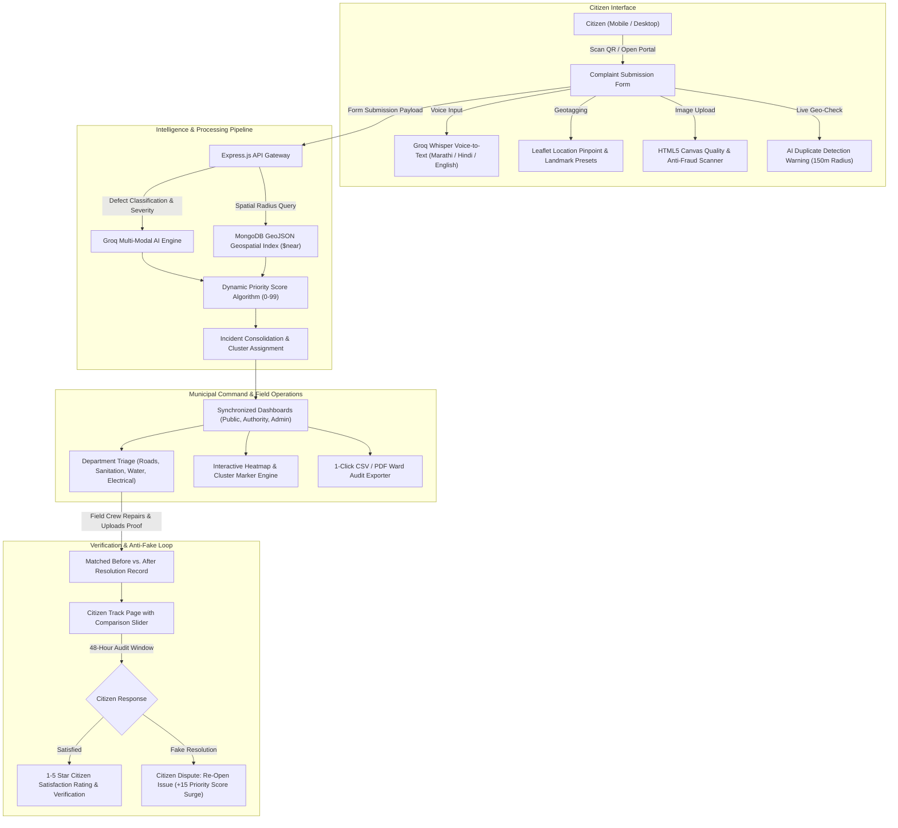

# CivicLens: AI-Powered Municipal Grievance Redressal & Resolution Verification System
### Comprehensive Technical Overview & Architecture Specification

---

## 1. Executive Summary & Abstract

**CivicLens** is an intelligent, civic-tech and smart-city e-governance platform designed for Urban Local Bodies (ULBs) such as the Pimpri-Chinchwad Municipal Corporation (PCMC) and Pune Municipal Corporation (PMC). 

Traditional municipal complaint channels suffer from high digital barriers, overwhelming redundant/duplicate tickets, unscientific first-come-first-served handling, and unverifiable "fake resolutions" marked by contractors without physical work. 

CivicLens solves these structural inefficiencies by providing:
- **Zero-login citizen reporting** with complete bilingual localization (**English & Marathi**) and speech-to-text reporting (**Marathi, Hindi, English**).
- **Computer vision & multi-modal AI** for automatic defect categorization, hazard severity assessment, and real-time image quality/anti-fraud auditing.
- **Pre-submission geospatial duplicate detection** (150m–220m radius) that converts potential duplicate tickets into community **"+1 Me Too" upvotes**, preventing helpline congestion.
- **Dynamic Risk Priority Scoring (0–99)** based on defect type, proximity to sensitive landmarks (schools, hospitals, transit terminals), and community upvote density.
- **Interactive "Before vs. After" visual resolution verification** accompanied by an enforceable **48-Hour Citizen Dispute Window** to eliminate fake closures.
- **Geospatial heatmaps and ward-level PDF/CSV export tools** enabling municipal leadership to allocate budget and deploy field squads based on real-time spatial density.

---

## 2. Project Domain & Industry Alignment

| Dimension | Specification |
|---|---|
| **Primary Domain** | **Civic Technology (Civic Tech) / Government Technology (GovTech) & Smart Cities** |
| **Sub-Domains** | Applied Artificial Intelligence (Computer Vision, NLP, Speech Recognition), Geospatial Information Systems (GIS), Full-Stack Systems Engineering |
| **National Alignment** | Smart Cities Mission (Ministry of Housing and Urban Affairs - MoHUA, Government of India), National Urban Digital Mission (NUDM) |
| **Anchor Locality** | Pimpri-Chinchwad (PCMC), Ward 20 (DY Patil Campus, YCM Hospital, Sant Tukaram Nagar, Vallabh Nagar ST Stand, Nehrunagar Sports Complex - 411018) |

---

## 3. Problem Statement

### 3.1 One-Line Summary
> *"Current civic grievance systems are slow, flooded with duplicate complaints, and plagued by unverifiable 'fake resolutions'."*

### 3.2 Formal Problem Definition
In municipal grievance redressal, legacy digital portals mandate tedious login credentials, OTP verifications, and English-only forms that alienate non-English-speaking citizens and blue-collar residents. Furthermore, when public infrastructure fails in busy commercial or educational hubs, municipal authorities are inundated with dozens of repetitive complaints for a single defect, diluting municipal response times. 

Crucially, existing systems lack an objective resolution verification mechanism, allowing contractors and ward officers to mark tickets as "Resolved" without physical remediation, eroding citizen trust. CivicLens addresses this breakdown by automating verification, spatial clustering, and community-driven accountability.

---

## 4. End-to-End System Architecture



---

## 5. Detailed Feature Catalog

### 5.1 Citizen Experience & Accessibility
1. **Frictionless Zero-Login Access:**
   - Citizens do not need to register, remember passwords, or wait for OTPs. They can file a report immediately via Web or Community QR codes placed at bus shelters, metro pillars, and college entrances.
2. **Comprehensive Bilingual Localization (English & Marathi):**
   - Implemented via a specialized `MutationObserver` DOM translation engine in `LanguageContext.jsx`.
   - Translates all dynamic content, navigational bars, badges, status banners, modals, and telemetry into standard Marathi in real time without refreshing or reloading the webpage.
3. **Multilingual Voice-to-Text Reporting:**
   - Powered by Web Audio recording and Groq's Whisper AI transcription.
   - Citizens can tap the microphone button and describe the issue in spoken Marathi, Hindi, or English. The engine transcribes and populates the description field instantly.
4. **Interactive Leaflet Location Pinpoint:**
   - Embedded in `LocationPickerMap.jsx`.
   - Features draggable pins, automatic browser GPS geolocation, and 1-click landmark presets for prominent PCMC hubs (e.g., DY Patil College, YCM Hospital, Sant Tukaram Nagar Metro, Vallabh Nagar ST Stand, Nehrunagar Stadium).
5. **Real-Time Client-Side Image Quality & Anti-Fraud Checker:**
   - Built inside `imageQualityChecker.js` using raw HTML5 `<canvas>` pixel inspection.
   - Computes grayscale variance, average brightness, and edge gradients.
   - Distinguishes between legitimate nighttime photos (e.g., dark streetlights) and fraudulent solid/blank screens, while warning users if a photo is too blurry or out of focus.
6. **Pre-Submission AI Duplicate Detection & "+1 Me Too" Fast-Tracking:**
   - As soon as the user selects a category and pinpoints their location, the client debounces a query to `/api/complaints/nearby-duplicates`.
   - If an active ticket exists within 150m, a warning card displays: *"Similar issue already reported 39m away. Don't create a duplicate ticket — tap +1 Upvote to fast-track it!"*
   - Clicking "+1 Affects Me Too" increments the existing ticket's report count and priority score without creating redundant database records.
7. **Transparent Status Tracking:**
   - Anyone can enter their format ID (`CL-YYYYMMDD-XXXX`) on the `/track` page to review progress, assigned department officers, field notes, and timeline milestones.

---

### 5.2 Verification & Anti-Fake Resolution Loop
1. **Interactive "Before vs. After" Resolution Slider:**
   - Built in `BeforeAfterSlider.jsx`.
   - When an issue is marked resolved, the system displays the original geotagged photo side-by-side with the field officer's post-repair photo via a draggable split slider.
   - Curated with genuine, same-location resolution pairs for potholes, garbage dumps, drainage repairs, and streetlights.
2. **48-Hour Citizen Dispute & "Re-open Issue" Safeguard:**
   - When an authority marks a ticket "Resolved", a 48-hour audit window begins.
   - If the fix was cosmetic, fraudulent, or incomplete, the citizen clicks **"Not Fixed Properly — Re-open Issue"**.
   - The backend transitions the ticket from `resolved` back to `in_progress`, marks `disputed: true`, increments `reopenedCount`, and injects a **+15 Priority Score surge** to escalate the matter on the supervisor's board.
3. **Citizen Satisfaction Star Rating:**
   - If the repair is authentic, the citizen selects a 1–5 star rating and enters written feedback, storing an immutable citizen verification record in MongoDB.

---

### 5.3 Municipal Command & Administrative Operations
1. **Interactive Geospatial Heatmap & Cluster Visualizer:**
   - Implemented in `IncidentHeatmap.jsx` using Leaflet.
   - Features dynamic thermal rings representing defect severity (Critical Red, High Orange, Medium Amber, Low Blue).
   - Includes real-time category filtering (Potholes, Sanitation, Water, Electrical), one-click hotspot jumping, and summary statistics.
2. **Synchronized Cross-Role Dashboards:**
   - Public, Department Authority, and Central Admin dashboards read from unified MongoDB collections.
   - Real-time Recharts visualizations display category distributions, 7-day volume trends, resolution rates, and ward rankings.
3. **1-Click Ward Report Generator (CSV & PDF):**
   - Built in `exportUtils.js`.
   - Allows municipal commissioners and ward corporators to export filtered incident audit reports into structured CSV spreadsheets or print-ready PDF summaries.
4. **Authority User Management Directory:**
   - Located in `AdminUsers.jsx`.
   - The central administrator (**Shailesh Bhabad**) can create new field engineers, modify contact credentials, assign specific zones (e.g., Zone B Pimpri Central), and activate/deactivate personnel with immediate database persistence.

---

## 6. Algorithmic Formulations & AI Heuristics

### 6.1 Dynamic Priority Score Formulation
When an incident is reported or updated, its Priority Score $P \in [10, 99]$ is calculated using a multi-factor weighting model:

$$P = \min\left(99, \; B_{\text{category}} + W_{\text{severity}} + W_{\text{urgency}} + W_{\text{hazard}} + W_{\text{proximity}} + W_{\text{community}}\right)$$

#### 1. Category Base Weight ($B_{\text{category}}$)
* **Water Leak / Pipeline Rupture:** $85$ (Critical potable water loss / road subgrade damage)
* **Drainage / Sewage Overflow:** $75$ (Public health and flooding hazard)
* **Pothole / Road Cavity:** $72$ (Accident and structural vehicle risk)
* **Streetlight / Electrical Failure:** $70$ (Pedestrian safety and nighttime crime risk)
* **Garbage / Solid Waste:** $68$ (Sanitation and epidemic vector)
* **General / Other:** $55$

#### 2. Contextual & Multiplier Adjustments
* **Sensitive Infrastructure Hazard ($W_{\text{hazard}}$):** $+22$ if keywords indicate proximity to schools, hospitals, kindergartens, or open high-voltage hazards.
* **Corridor & Traffic Density ($W_{\text{proximity}}$):** $+12$ for high-speed highways, main campus gates, metro stations, or ST bus terminals.
* **Community Upvote Weight ($W_{\text{community}}$):** $+3$ for every "+1 Me Too" upvote received from nearby residents.
* **Dispute Escalation:** $+15$ if a citizen disputes a fake resolution.
* **Minor Adjustment:** $-18$ if the description explicitly indicates a minor, non-blocking cosmetic fault.

---

### 6.2 Image Quality & Anti-Fraud Pixel Heuristic
The image analyzer samples downsampled canvas pixel buffers $I(x,y)$ to extract:
1. **Average Luminance ($\mu_L$):**
   $$\mu_L = \frac{1}{N} \sum_{i=1}^{N} (0.299 R_i + 0.587 G_i + 0.114 B_i)$$
   - $\mu_L < 10 \implies$ Severely dark image (score $-30$).
   - $10 \le \mu_L < 25 \implies$ Night/low-light scene allowed (score $-10$).
   - $\mu_L > 248 \implies$ Overexposed/blown-out white image (score $-25$).
2. **Color Variance & Solid Screen Detection ($\sigma^2$):**
   $$\sigma^2 = \frac{1}{N} \sum_{i=1}^{N} (L_i - \mu_L)^2$$
   - $\sigma < 6 \implies$ Solid blank screen or lens obstruction (Anti-Fraud Flag, rejected).
3. **Average Gradient / Sharpness ($G$):**
   $$G = \frac{1}{N-1} \sum_{i=2}^{N} |L_i - L_{i-1}|$$
   - $G < 4.5 \text{ and } \sigma < 15 \implies$ Blurry image warning (score $-15$).

---

## 7. Database Architecture & Schema Models

The database runs on MongoDB using Mongoose schemas:

### 7.1 Complaint Schema (`models/Complaint.js`)
```javascript
{
  trackingId: { type: String, unique: true, index: true }, // e.g. "CL-20261011-POTH1"
  description: { type: String, required: true },
  imageUrl: { type: String, required: true },
  category: { 
    type: String, 
    enum: ['pothole', 'garbage', 'water_leak', 'streetlight', 'drainage', 'other'],
    required: true 
  },
  severity: { type: String, enum: ['low', 'medium', 'high', 'critical'], default: 'medium' },
  urgency: { type: String, enum: ['immediate', 'within_24h', 'within_3d', 'scheduled'], default: 'within_24h' },
  status: { 
    type: String, 
    enum: ['submitted', 'analysing', 'verified', 'assigned', 'in_progress', 'resolved', 'rejected'],
    default: 'submitted',
    index: true
  },
  source: { type: String, enum: ['community_qr', 'portal', 'voice_bot', 'mobile'], default: 'portal' },
  location: {
    type: { type: String, enum: ['Point'], default: 'Point' },
    coordinates: { type: [Number], required: true } // [longitude, latitude]
  },
  address: { type: String, required: true },
  ward: { type: String },
  zone: { type: String },
  landmark: { type: String },
  incidentId: { type: Schema.Types.ObjectId, ref: 'Incident', index: true },
  isMerged: { type: Boolean, default: false },
  mergedReportsCount: { type: Number, default: 1 },
  mergeReason: { type: String },
  
  // Verification & Anti-Fake Resolution
  resolutionNotes: { type: String },
  resolutionImage: { type: String },
  resolvedAt: { type: Date },
  resolvedBy: {
    name: String,
    department: String,
    role: String
  },
  disputed: { type: Boolean, default: false },
  disputeReason: { type: String },
  disputedAt: { type: Date },
  reopenedCount: { type: Number, default: 0 },
  citizenVerified: { type: Boolean, default: false },
  citizenRating: { type: Number, min: 1, max: 5 },
  citizenFeedback: { type: String },
  
  // AI Diagnostics
  ai_analysis: {
    category: String,
    severity: String,
    urgency: String,
    confidence: Number,
    imageValid: Boolean,
    explanation: String
  }
}
```

### 7.2 Incident Schema (`models/Incident.js`)
Consolidates clustered complaints within a 150m geographic radius:
```javascript
{
  title: { type: String, required: true },
  category: { type: String, required: true },
  severity: { type: String, required: true },
  urgency: { type: String, required: true },
  priorityScore: { type: Number, min: 0, max: 99, default: 50, index: true },
  location: {
    type: { type: String, enum: ['Point'], default: 'Point' },
    coordinates: { type: [Number], required: true }
  },
  address: { type: String, required: true },
  ward: { type: String },
  zone: { type: String },
  department: { type: String, required: true },
  status: { type: String, default: 'reported' },
  complaints: [{ type: Schema.Types.ObjectId, ref: 'Complaint' }],
  reportCount: { type: Number, default: 1 },
  assignedTo: {
    name: String,
    email: String,
    department: String,
    assignedAt: Date
  },
  resolutionNotes: String,
  resolutionImage: String,
  resolvedAt: Date,
  resolvedBy: {
    name: String,
    department: String
  }
}
```

### 7.3 User Schema (`models/User.js`)
```javascript
{
  name: { type: String, required: true },
  email: { type: String, required: true, unique: true },
  password: { type: String, required: true },
  role: { type: String, enum: ['citizen', 'authority', 'admin'], default: 'citizen' },
  department: { type: String }, // e.g. Roads, Sanitation, Water Supply, Electrical
  zone: { type: String },
  isActive: { type: Boolean, default: true }
}
```

---

## 8. REST API Endpoint Specification

### 8.1 Citizen & Complaint Routes (`/api/complaints`)
| Method | Route | Description |
|---|---|---|
| `POST` | `/api/complaints` | Submits a new citizen complaint; invokes Groq AI and merges into nearby cluster if duplicate exists. |
| `POST` | `/api/complaints/voice-process` | Uploads multipart audio recording; returns transcribed text via Groq Whisper. |
| `GET` | `/api/complaints/nearby-duplicates` | Pre-submission query (`lat`, `lng`, `category`, `radius=150m`) to find active nearby duplicates. |
| `GET` | `/api/complaints` | Retrieves all complaints (supports filtering by ward, status, category). |
| `GET` | `/api/complaints/my` | Retrieves complaints filed in current session/user context. |
| `GET` | `/api/complaints/:trackingId` | Retrieves complete details and timeline milestones for a specific tracking ID. |
| `PUT` | `/api/complaints/:id/resolve` | Marks ticket resolved, attaches Before/After images, and updates parent incident. |
| `PUT` | `/api/complaints/:id/status` | Updates workflow status (`submitted` $\rightarrow$ `assigned` $\rightarrow$ `in_progress`). |
| `POST` | `/api/complaints/:id/reopen` | 48-hour dispute trigger; reverts status to `in_progress` and applies $+15$ score boost. |
| `POST` | `/api/complaints/:id/verify-resolution` | Records citizen 1–5 star rating and feedback confirmation. |

### 8.2 Incident & Heatmap Routes (`/api/incidents`)
| Method | Route | Description |
|---|---|---|
| `GET` | `/api/incidents` | Retrieves all clustered incidents with coordinates, report counts, and priority scores. |
| `GET` | `/api/incidents/:id` | Retrieves full incident record including all associated complaints. |
| `PUT` | `/api/incidents/:id/status` | Updates incident status across all grouped child complaints. |
| `POST` / `PUT` | `/api/incidents/:id/upvote` | Citizen "+1 Me Too" upvote; bumps `reportCount` and increases priority score. |

### 8.3 Authentication & User Directory (`/api/auth`)
| Method | Route | Description |
|---|---|---|
| `POST` | `/api/auth/login` | Authenticates administrator or department authority officers. |
| `GET` | `/api/auth/users` | Admin only: returns list of registered department officers. |
| `POST` | `/api/auth/users` | Admin only: registers a new department officer with assigned zone and role. |
| `PUT` | `/api/auth/users/:id` | Admin only: edits officer details or toggles active status. |
| `DELETE` | `/api/auth/users/:id` | Admin only: deletes an officer account with instant MongoDB synchronization. |

---

## 9. Technology Stack

```
┌────────────────────────────────────────────────────────┐
│                        CLIENT                          │
│  React 18  │  Vite  │  Tailwind CSS  │  Leaflet GIS    │
│  Recharts  │  Lucide Icons  │  Canvas API  │  jsPDF    │
└──────────────────────────┬─────────────────────────────┘
                           │ HTTP / JSON REST APIs
┌──────────────────────────▼─────────────────────────────┐
│                        SERVER                          │
│  Node.js (ES Modules)  │  Express.js  │  Mongoose ODM  │
│  Groq SDK (Llama 3 & Whisper AI)  │  Multer Audio      │
└──────────────────────────┬─────────────────────────────┘
                           │ Native Driver & Geospatial Indices
┌──────────────────────────▼─────────────────────────────┐
│                       DATABASE                         │
│  MongoDB Local (27017)  │  2dsphere GeoJSON Indexing   │
└────────────────────────────────────────────────────────┘
```

---

## 10. Key Engineering Challenges Solved

| Challenge | Root Cause | Engineering Solution |
|---|---|---|
| **Non-Pothole Categories Showing Pothole Images** | Fallback functions in the client and server defaulted to `pothole_before.jpg` and `pothole_after.jpg`. | Completely decoupled image getters. Mapped `streetlight`, `other`, `drainage`, and `water_leak` to dedicated neutral infrastructure assets (`drainage_before.jpg`, `drainage_after.jpg`, `garbage_before.jpg`, etc.). Ran database migration to update existing records. |
| **Flat Baseline Priority Scoring** | Server-side AI fallback defaulted all unflagged complaints to a generic score of `65` regardless of true danger. | Rewrote `fallbackAnalysis()` in `groqService.js` with category-aware base scores (`water_leak=85`, `drainage=75`, `pothole=72`, `streetlight=70`, `garbage=68`, `other=55`) refined by danger keyword boosts. |
| **Nighttime Streetlights Flagged as Fake Photos** | The canvas brightness threshold `< 28` was overly restrictive, falsely rejecting genuine dark photos taken under broken lamps. | Calibrated brightness and variance algorithms in `imageQualityChecker.js` down to `< 10` for extreme blackouts and `< 6` for flat screens, allowing genuine night shots to pass with a "low-light" tag. |
| **Leaflet Map Unmount Lifecycle Crash** | Switching views while a Leaflet map was initializing threw `TypeError: Cannot read properties of undefined (reading '_leaflet_pos')`. | Added timeout clearance, mounted state refs, and guarded try/catch blocks to `map.invalidateSize()` and `map.remove()` in `IncidentHeatmap.jsx` and `LocationPickerMap.jsx`. |
| **Partial Marathi Localization** | Dynamic JSX template literals and newly added modal buttons were missing from the translation dictionary. | Expanded `DOM_TRANSLATIONS` in `LanguageContext.jsx` with over 100+ new entries and added safe proxy fallbacks to avoid unhandled render errors during hot-module reloads. |

---

## 11. Quickstart & Execution Guide

### 11.1 Prerequisites
- **Node.js:** v18.0.0 or higher (v20+ recommended)
- **MongoDB:** Active on `mongodb://127.0.0.1:27017/civiclens`

### 11.2 Terminal Commands

#### Terminal 1: Backend Server (Port 5000)
```powershell
# Navigate to the server folder
cd c:\Users\Shailesh\Antigravity\Civiclens\server

# Install dependencies (first-time only)
npm install

# Start the Express server
npm start
# Alternatively: node src/index.js
```
*Health Check:* Open `http://localhost:5000/api/health` in your browser.

#### Terminal 2: Frontend Client (Port 5173)
```powershell
# Navigate to the client folder
cd c:\Users\Shailesh\Antigravity\Civiclens\client

# Install dependencies (first-time only)
npm install

# Launch Vite development server
npm run dev
```
*Application Access:* Open `http://localhost:5173/` in your browser.

### 11.3 Default Credentials
- **Central Municipal Admin:**
  - **Email:** `admin@civiclens.in`
  - **Password:** `171264`
  - **Permissions:** Full municipal oversight, ward analytics, user directory management.
- **Roads Department Officer:**
  - **Email:** `authority@civiclens.in`
  - **Permissions:** Field assignment triage, status updates, before/after proof upload.
